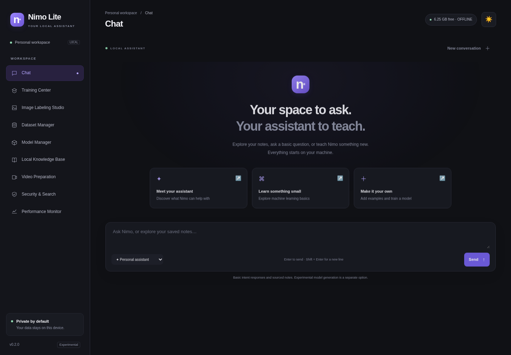
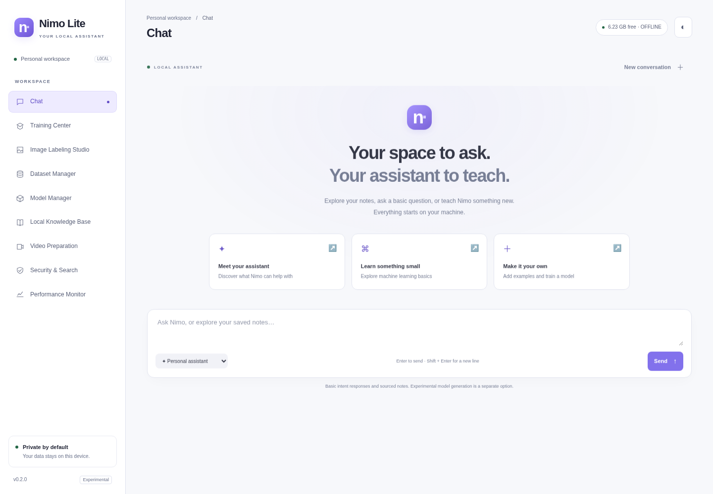

# Nimo Lite

**A local assistant you can teach, inspect, and improve.**

[Getting started](#getting-started) · [Starter models](#use-the-trained-starter-models) · [Training guide](#teach-nimo-with-your-data) · [Model card](docs/STARTER_MODEL_CARD.md) · [Security](SECURITY.md)

Nimo Lite is an open-source experimental personal AI workbench. Chat with saved knowledge, use a small trained NLP intent assistant, label images, and train original models from random weights through a local web interface.

**v0.2.0:** dark and light themes, a guided training workflow, reviewed starter data, an original trained intent classifier, and a separately trained byte-level language model. No pretrained weights are downloaded or renamed. Application source is MIT licensed; original starter data and starter weights are CC0-1.0. The GitHub repository currently remains private; its visibility has not been changed.

> This is a small working foundation, not an advanced general assistant. The released language model can produce corrupted or incorrect text. Recommended assistant mode uses clearly identified intent routing and authored responses, with separate sourced knowledge retrieval. See the unedited results and limitations in the model card.

| Dark workspace | Light workspace |
|---|---|
|  |  |

## Getting started

Python 3.10+ is required. Initial dependency installation requires internet; core local use does not.

```bash
git clone https://github.com/nadeemmhdm/nimo-lite.git
cd nimo-lite
python -m venv .venv
source .venv/bin/activate
# Windows PowerShell: .venv\Scripts\Activate.ps1
python -m pip install --upgrade pip
# CPU-only example; use the official PyTorch selector for a compatible GPU wheel.
python -m pip install torch --index-url https://download.pytorch.org/whl/cpu
python -m pip install -e '.[test]'
nimo-lite --data ./data --port 8080
```

Open **http://127.0.0.1:8080**. Run one server per data directory. The server intentionally binds to loopback; do not expose it through a tunnel or reverse proxy. Linux CPU execution is verified. Windows, macOS, CUDA, and Metal remain unverified implementation targets.

The top-right theme button switches between dark and light. The first visit follows your system preference; your choice is saved only in this browser. On small screens, use the menu button to open navigation.

## Use the trained starter models

Download `nimo-lite-starter-v0.2.0.zip` from [Releases](https://github.com/nadeemmhdm/nimo-lite/releases). Repository access is required while the repository is private. Verify its checksum against `SHA256SUMS`, then install locally:

```bash
python -m nimo.install nimo-lite-starter-v0.2.0.zip --data ./data
nimo-lite --data ./data
```

Installation reads a bounded local archive with fixed model filenames and verified hashes. It activates the accepted checkpoints and preserves older versions. It does not fetch URLs, upload data, or automatically approve training examples. A separate immutable public test set allows reevaluation without importing it into your personal training dataset.

| Component | Training performed | Actual held-out result |
|---|---|---|
| Basic assistant NLP | Randomly initialized 22,539-parameter intent classifier; 11 labels, 60 epochs | 7/11 correct requests; macro F1 0.5303 |
| Experimental text model | Original 133,120-parameter causal Transformer; 256-byte context, 80 epochs | Byte accuracy 47.09%; perplexity 88.74 |

Both used only the bundled original educational corpus: 140 examples, no scraped data or private user content. These small internal holdouts are not proof of real-world assistant quality. [Model card](docs/STARTER_MODEL_CARD.md) · [Complete training record and probes](docs/starter-training-results.json)

## What happens when you chat?

| Mode | Behavior | Weight updates during chat? |
|---|---|---|
| Personal assistant | Retrieves matching local notes; otherwise uses the active intent classifier to select an allowlisted authored response | No |
| Local knowledge only | Returns matching saved notes with sources | No |
| Experimental text model | Generates bytes from your active original language-model checkpoint | No |

The interface identifies the response source. Basic assistant behavior is friendly, local, and honest about uncertainty. An intent label can select an authored response, never a shell command, file operation, or network tool. Low-confidence predictions use an uncertainty response; scores are uncalibrated and misclassification remains possible.

## Teach Nimo with your data

The Training Center guides four real steps: **prepare → review → train → evaluate**.

1. **Prepare.** Add a question and checked answer with provenance and usage permission, import a JSON dataset, upload images, or load the original starter examples.
2. **Review.** Search and filter in Dataset Manager. Select individual examples or a page, inspect their contents and sources, and explicitly acknowledge review before bulk approval. Flagged examples require individual review.
3. **Train.** Choose basic NLP intents, text generation, or image classification. Check the dataset, set epochs, and start a separate local training worker. The app reports real progress and loss. Pause, save, resume, and stop safely at batch boundaries.
4. **Evaluate.** Inspect held-out results in Model Manager. Validation gates determine activation; test metrics do not select versions. Restore accepted versions or export their checkpoints.

Saving knowledge, entering examples, submitting feedback, training a classifier, and updating language-model weights remain distinct actions. No improvement is claimed until an actual training run and evaluation complete.

### Text and NLP

The original tokenizer encodes UTF-8 bytes plus PAD/BOS/EOS. New language training masks prompt targets and optimizes answer prediction, with a 128- or 256-byte context. Long questions are truncated to reserve space for an answer. English, Malayalam, Manglish, code, and mathematics examples can be stored; the tokenizer alone does not confer fluency or reasoning.

The separate intent architecture uses stable hashed word/character features and a trainable 11-class linear head. Use `intent:greeting`, `intent:identity`, and other supported categories shown in the example-type selector. Labels train recognition; response policy remains explicit application code. This keeps arbitrary imported targets from silently becoming executable assistant behavior.

### Images and video

Upload JPEG, PNG, and WebP images individually, in batches, or with a browser folder picker. Original bytes remain separate from processed previews. Add labels and notes, verify them, and explicitly approve for training. Classifier suggestions are unverified until you review them. Rename, merge, or remove categories; affected examples return to review.

Classification requires exactly one verified label and independent samples in each split. Bounding boxes and multiple labels are supported for annotation and COCO export; detector training, OCR, captions, and visual question answering are not implemented. Optional `pip install -e '.[video]'` enables local timestamped frame extraction, not video understanding or audio transcription.

### Checkpoints and recovery

Atomic checkpoints contain weights, optimizer/RNG state, epoch/batch offset, sample versions, checksums, and split IDs. Resume requires unchanged data and a sufficient total epoch target. Prior training overlap is checked by IDs and checksums before comparing current held-out data. Approximate image grouping and normalized text questions reduce some leakage; they do not identify every related example.

## Local privacy and resources

Offline is the default. There is no telemetry, remote inference, or automatic weight download. Optional Wikipedia search sends only an explicit query after you enable online mode; results carry links and retrieval dates and never enter memory or training automatically.

Input bounds, path validation, a local session token, Host/Origin checks, local assets, and a strict content policy protect the single-user application boundary. Native dependencies still run as your OS user. Storage is not encrypted, and there is no hard memory sandbox or universal injection guarantee. [Security policy](SECURITY.md)

The intended minimum is 6 GB RAM. Conservative profiles choose small batches, at most two CPU threads, one training worker, and bounded model shapes. RAM detection honors Linux cgroups, and available memory is checked before training and between batches. Validation ran with an 8 GiB cgroup ceiling; no physical 6 GB benchmark is claimed.

Export datasets or models from the dashboard. Stop the app before backing up the whole data directory. Deletion removes local rows/files but is not secure erasure or machine unlearning. Private data, tokens, environments, and weights are ignored by Git. The release model bundle was built only from original public fixtures in a separate training directory.

## Reproduce and contribute

```bash
python -m pytest -q
python scripts/build_starter_data.py
# Requires a fresh output directory; only original bundled data is trained.
python scripts/train_starter.py --root artifacts/my-independent-run
```

**26 automated tests** cover real training/recovery, intent routing, installed-model reevaluation, review gates, media annotation, privacy, request boundaries, and data leakage checks. Playwright checks dark/light persistence, mobile layout, chat, labeling, bulk review, export, and evaluation. See [verification](docs/EVALUATION.md).

[Architecture](docs/ARCHITECTURE.md) · [Installation](docs/INSTALLATION.md) · [Troubleshooting](docs/TROUBLESHOOTING.md) · [Contributing](CONTRIBUTING.md) · [Changelog](CHANGELOG.md) · [Roadmap](ROADMAP.md) · [Third-party notices](THIRD_PARTY_NOTICES.md)
