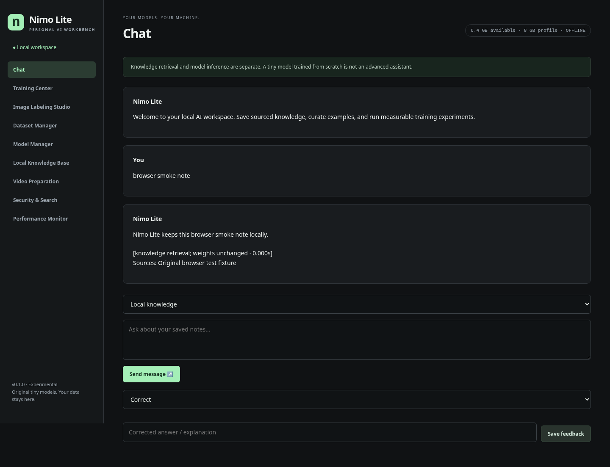

# Nimo Lite

**Your models. Your machine. Your learning process.**

Nimo Lite is an open-source, local-first experimental AI workbench with a compact, llama.cpp-inspired web interface. Repository name: `nemo-lite`; application and model name: **Nimo Lite**.

Train a small original language model or a separate image classifier from random initialization. Label your own images, review examples, save local knowledge, monitor training, and retain versioned checkpoints. No pretrained weights are bundled, downloaded, or renamed.

> **Status: v0.1.0 experimental foundation.** This is not a generally capable personal assistant. Small, locally trained models can produce nonsense and incorrect answers. No advanced reasoning, coding, Malayalam fluency, OCR, object detection training, or visual question answering capability is claimed.



## Quick start

Python 3.10+ is required. Initial dependency installation needs internet access; core operation does not.

```bash
python -m venv .venv
# Linux / macOS
source .venv/bin/activate
# Windows PowerShell: .venv\Scripts\Activate.ps1
python -m pip install --upgrade pip
# For CPU-only systems, install the appropriate CPU wheel first:
python -m pip install torch --index-url https://download.pytorch.org/whl/cpu
python -m pip install -e '.[test]'
nimo-lite --data ./data --port 8080
```

Open **http://127.0.0.1:8080** locally. The server intentionally binds to loopback. Do not reverse-proxy or expose it to a network. Linux CPU execution is the verified target; Windows, macOS, CUDA, and Apple Metal are implementation targets awaiting device-specific testing.

## Three distinct learning modes

| Mode | What it does | Changes weights? |
|---|---|---|
| A · Knowledge | Stores sourced notes in SQLite; retrieves lexical matches with citations | No |
| B · Task training | Trains the original CNN on approved single-label images | Yes, classifier only |
| C · Language training | Trains the original byte-level Transformer on approved text examples | Yes, text model only |

Feedback and example entry are curation steps. They are never represented as completed model training.

## Teach images

1. Open **Image Labeling Studio**. Enter source and license/authorized-use information.
2. Upload JPEG, PNG, or WebP files individually, in batches, or with the browser folder picker.
3. Select an image, enter labels and optional notes. Drag to annotate bounding boxes after entering a box label.
4. Mark labels verified and explicitly approve for training. Classification training requires exactly one label per image. Multiple labels and boxes remain available for annotation/export.
5. Add at least three independent image groups in **each** category, preferably many more. Near-duplicate images are grouped conservatively to reduce split leakage.
6. In **Training Center**, validate the image dataset, choose epochs, and start training.
7. Inspect loss, validation results, and held-out test metrics in **Model Manager**. New versions activate only when acceptance criteria pass.
8. Use **Suggest / Classify** for an unverified prediction from the accepted local classifier. Accepting copies a label into the editor; save and approve it explicitly.

Original upload bytes are preserved separately from normalized PNG copies. Export contains both copies, provenance, labels, and COCO bounding boxes. Deletion removes image files and sample rows; existing checkpoints may still encode information learned previously.

## Teach text

Enter question/instruction, expected answer, category, source, and usage declaration. English, Malayalam, Manglish, mathematics, and code can be stored without requiring separate tokenizers. Review and approve in **Dataset Manager**. Sensitive or suspicious examples require explicit acknowledgment. Validation detects normalized-question conflicts and empty splits.

Start **Language model** training. The tokenizer encodes UTF-8 bytes with PAD/BOS/EOS tokens. The tiny causal Transformer uses 128-byte contexts, two 64-wide layers, and next-byte loss. Unicode round trips are supported; this does not establish multilingual conversational proficiency. Long examples are truncated for training, so keep experiments short.

The included JSON examples are original CC0 smoke-test material, not a trusted factual corpus or an accuracy benchmark. Verify licenses, consent, and correctness of every imported dataset yourself. The application records declarations; it cannot establish legal permission or truth automatically.

## Training lifecycle

- One child process trains at a time, separately from web requests and inference.
- Pause, resume, save, and safe stop apply at batch boundaries. Paused workers retain RAM.
- Checkpoints contain model, optimizer, RNG state, epoch, batch offset, sample versions, and split IDs. Writes use atomic replacement.
- To resume a stopped/interrupted run, paste its checkpoint ID and choose a larger total epoch target if required. Dataset content, versions, labels, and splits must match.
- Accepted versions can be restored without deleting later experiments. Failed acceptance never replaces the active model.
- Current and previous models are compared on the same validation split when label spaces match. Evaluation refuses obvious prior-training overlap with current held-out IDs.
- Test results are reported after training and do not govern acceptance. Small repeated experiments can still overfit validation; use a fresh independent external evaluation set for real claims.

## Privacy and security

Offline is the default. No telemetry, remote inference, automatic model downloads, or automatic document ingestion is implemented. Online mode only enables explicit Wikipedia search queries, with source links and retrieval dates. Search results never enter memory or training automatically.

The server checks Host and Origin, requires a local session token for mutations, and serves scripts/styles locally under a strict content policy. Models have no filesystem, shell, URL, or network tool interface. Imported text and model outputs are rendered as text. Checkpoints use PyTorch `weights_only=True`; arbitrary uploaded checkpoints are not supported.

This is a single-user local prototype, not a hardened multiuser service. Dataset storage is not encrypted. Use an encrypted disk and a trusted OS account. See [SECURITY.md](SECURITY.md) for boundaries and residual risks.

## Project layout

```text
nimo/                  Python application and original models
  static/              Local HTML/CSS/JavaScript dashboard
  store.py             SQLite metadata, images, review and knowledge
  datasets.py          Deterministic leakage-group splits
  models.py            Byte tokenizer, causal Transformer, CNN
  training.py          Training, metrics, checkpointing, resumption
  app.py               Loopback HTTP API and background job controller
  video.py             Optional sequential video frame preparation
  hardware.py          RAM/cgroup detection and conservative profiles
tests/                 Functional, training and security regression tests
examples/              Original synthetic teaching examples
docs/                  Architecture, setup, evaluation and limitations
data/                  Ignored local datasets, tokens, logs and weights
```

## Test and contribute

```bash
python -m pytest -q
```

See [CONTRIBUTING.md](CONTRIBUTING.md), [docs/ARCHITECTURE.md](docs/ARCHITECTURE.md), [docs/INSTALLATION.md](docs/INSTALLATION.md), [docs/TROUBLESHOOTING.md](docs/TROUBLESHOOTING.md), [docs/EVALUATION.md](docs/EVALUATION.md), and [ROADMAP.md](ROADMAP.md).

Code is [MIT licensed](LICENSE). Dataset declarations and third-party dependencies retain their own terms. See [THIRD_PARTY_NOTICES.md](THIRD_PARTY_NOTICES.md). Release notes: [CHANGELOG.md](CHANGELOG.md).
