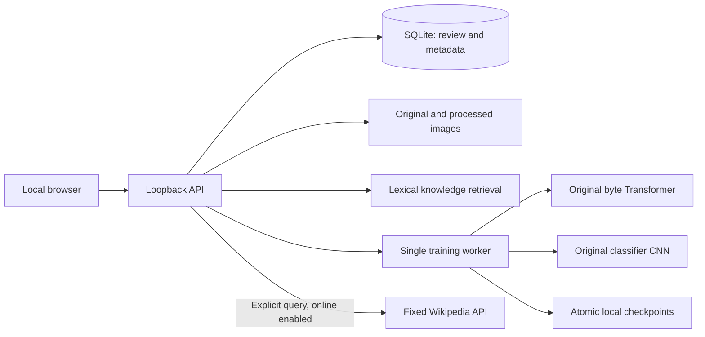

# Architecture

## Components and trust boundaries

The local browser communicates with one loopback FastAPI process. SQLite in WAL mode stores samples, knowledge, feedback, jobs, model metadata, and audit events. Image bytes, processed PNGs, local model files, and logs are stored under the chosen data directory. The default is `./data` relative to the launch directory.

The server launches one fixed Python module in a child process for training. Generated text and dataset content never enter command arguments, a shell, or Python evaluation. No model tools are exposed. The worker shares the user's OS privileges; it is not a native sandbox. Optional video decoding should only process trusted local files.

## Original models

**NimoLM**: a UTF-8 byte tokenizer with 259 tokens (256 byte values plus PAD, BOS, EOS), 64-dimensional token/position embeddings, two causal Transformer encoder blocks, four attention heads, 192-dimensional feed-forward layers, LayerNorm, and a vocabulary projection. Causal masks prevent future-token attention. All weights use random framework initialization. Training predicts the next byte over the first 128 targets of each formatted question/answer example. No pretrained tokenizer, embeddings, or weights are used.

**NimoVision**: two convolution layers (3→16→32), ReLU, spatial pooling, a 512→64 projection, and a class head. Input is RGB, resized bilinearly to 32×32 and scaled to [0,1]. This architecture is for single-label classification, not boxes, captions, OCR, or vision-language reasoning.

Training uses AdamW with learning rate 0.003, clipped gradient norm 1, deterministic per-epoch sample order, and seed 42. CUDA and Metal detection are implemented; CPU is the tested execution path. Checkpoint files include optimizer and RNG states plus a version/checksum snapshot.

## Splits and evaluation

Exact duplicate imports are rejected using canonical decoded-image or normalized text-pair checksums. Image average-hash distance at most four creates transitive near-duplicate groups; normalized equal text questions share groups. Groups are partitioned deterministically by class. Each class assigns its first group to test, its second to validation, and all remaining groups to training. This deliberately conservative small-data split is not a configurable production split strategy.

A near-duplicate image group with inconsistent labels fails validation. Every image category must exist independently in every split. A tiny validation/test set is sufficient only to verify execution, not establish generalization. The approximate hash can miss related images or incorrectly group unrelated images. Video frames from the same clip are not yet guaranteed to share a split, so do not use frame datasets as evidence of independent video generalization.

New runs begin from random weights unless a local checkpoint is explicitly selected. The worker compares validation loss against random initialization or a compatible active version evaluated on the same validation data. Image accuracy must also reach at least 0.5 and not fall below the reference. Test data is measured after training, not used for activation. Cross-task capability regression gates are not implemented.

## Resource behavior

RAM detection includes Linux cgroup limits. Profiles choose batches 2/4/8/16 for memory tiers 6/8/16/32 GB; all use fixed small architectures, 128-byte contexts, 32×32 inputs, and at most two CPU threads. Training requires 1.5 GiB available memory and 0.2 GiB disk before launch; the worker checks for less than 0.5 GiB available at batch boundaries. VRAM below 1 GiB causes CPU fallback. This does not reserve memory or enforce an OS quota. A single forward/backward step cannot be interrupted safely until it completes.

Imports are bounded to 12 MiB per request and 16 MP per image; datasets are limited to 5000 samples. Image tensors are loaded on demand by batch. The API still reads sample metadata and assembles ZIP exports in memory; keep datasets small. Dataset mutation is blocked during queued, running, or paused jobs. Separate inference requests load only the selected local model and are serialized with a lock.
