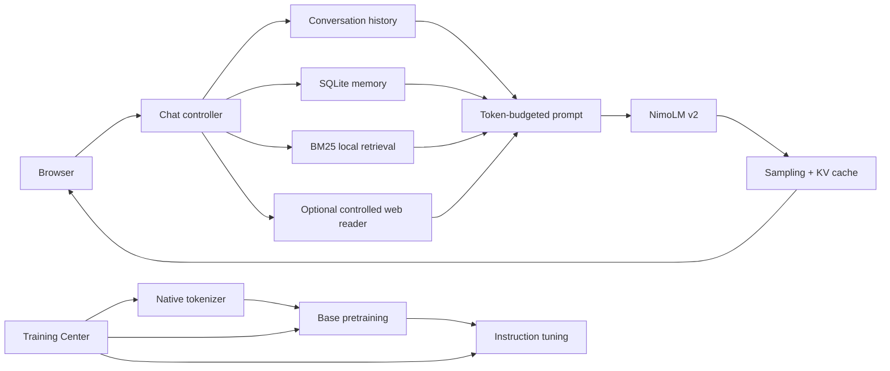

# Architecture

## Trust boundary

Nimo Lite is a single-user loopback application. The browser talks to one local FastAPI process; SQLite and model/data files live under the selected data root. Training runs in a child Python process. Nimo-generated text is never evaluated as Python, shell, SQL, or a network command.

## Native tokenizer

`nimo/tokenizer.py` implements a locally trained byte-subword tokenizer. It begins with a complete 256-byte fallback alphabet, so arbitrary UTF-8 always round-trips, then learns frequent variable-length byte pieces from approved local text. This is a subword method in the BPE family of goals: frequent sequences become one token while unknown sequences remain representable.

Reserved tokens are `PAD`, `BOS`, `EOS`, `SYSTEM`, `USER`, `ASSISTANT`, `TOOL`, and `MEMORY`. Artifacts are JSON, checksum-protected, bounded during loading, and stored under `data/tokenizer/tokenizer.json`. Checkpoints embed the exact tokenizer artifact/hash used for training.

## NimoLM v2

New language models use `NimoLMV2`, a decoder-only causal Transformer implemented with PyTorch primitives:

- RMSNorm
- rotary positional embeddings (RoPE)
- causal scaled-dot-product self-attention
- SwiGLU feed-forward blocks
- tied token/output embeddings
- configurable dropout
- depth-aware residual initialization
- KV-cache incremental decoding

Profiles with an 8k vocabulary are approximately Tiny 13M, Small 32M, and Medium 88M parameters. Context is configurable to 256/512/1024/2048/4096 tokens. Actual parameter count depends on vocabulary size.

Legacy byte Transformer checkpoints remain loadable through separate compatibility classes. Architecture schema version 3 identifies the modern `nimo_lm_v2` family; this is independent of the application version.

## Training objectives

**Pretraining** consumes approved `raw`, `knowledge`, `code`, and `math` documents and optimizes next-token prediction.

**Instruction tuning** consumes reviewed question/answer and multi-turn conversation data. System/user/tool tokens are context and receive `-100` targets; assistant content and assistant EOS tokens receive loss.

Training supports AdamW, gradient accumulation, warmup + cosine decay, clipping, pause/save/resume/stop commands, periodic atomic checkpoints, validation/test measurement, best-validation tracking, tokens/second, loss history, CPU/CUDA/MPS execution, and mixed precision where supported.

## Context assembly

A normal assistant turn is composed from:

1. immutable system behavior
2. relevant low-risk long-term memories
3. local BM25 knowledge/corpus passages
4. optional explicitly enabled web evidence
5. recent persistent chat messages
6. the current user message
7. `ASSISTANT` generation marker

The builder measures tokenizer IDs against the model context. Recent messages are preserved preferentially. Older omitted messages receive a compact local extractive summary. System instructions are retained. The runtime exposes context-use metadata.

## Memory

Memory is separate from model weights. `LocalMemory` stores conservative low-risk user facts in SQLite and provides list/delete/clear controls. Automatic extraction filters secrets, contact-like credentials, precise location patterns, and sensitive personal categories. Memory retrieval is lexical and injected as the `MEMORY` role.

## Local RAG

`nimo/retrieval.py` implements Unicode-aware BM25. It ranks saved knowledge and approved corpus documents without an external embedding model. Retrieved text is labeled as data, not instructions, and sources are returned to the UI.

## Generation

Modern generation provides temperature, top-k, top-p, repetition penalty, frequency penalty, presence penalty, maximum new tokens, EOS stop, custom stop sequences, seed, and deterministic mode. KV-cache generation streams decoded text progressively.

## Dataset architecture

The legacy reviewed sample manager remains for image, intent, and compatibility Q&A tasks. The new scalable corpus store adds documents with source, license, language, category, quality/review status, checksum, stable split, version, and metadata. Exact and conservative SimHash near-duplicate checks are applied. Stable checksum splits prevent silent train/test movement.

## Compatibility components

- `NimoIntent`: optional classifier/router only; it does not answer normal chat.
- `NimoVision`: existing local image classifier.
- legacy byte language checkpoints: loadable for compatibility.
- existing model manager, review flows, themes, image/video preparation, exports, and knowledge base remain available.

## Online boundary

Core use is offline. Optional search/page/PDF reading uses a controlled client that blocks private/loopback/reserved network destinations, revalidates redirects, limits ports and bytes, strips active HTML content, and marks returned text untrusted.
